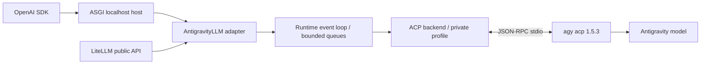

# Thiết kế backend ACP

## Cấu trúc đã triển khai

ACP v1 qua stdio của `agy acp` 1.5.3; mỗi request tạo một subprocess/session.
Provider tách khỏi giao thức và có một runtime event loop riêng để dùng chung
semaphore, process ownership và cleanup giữa cả caller sync lẫn async.



Host dùng adapter/converter trực tiếp thay vì chạy LiteLLM Proxy hoặc đi vòng
qua registry global của `litellm.acompletion`. Quyết định này giữ quyền sở hữu
HTTP disconnect, không tự ước lượng usage và không đưa retry mặc định vào đường
HTTP. `AntigravityLLM(CustomLLM)` vẫn triển khai đủ completion, acompletion,
streaming và astreaming; test gọi cả bốn qua public LiteLLM API 1.109.0.

| Module | Trách nhiệm |
|---|---|
| config.py | Model aliases, executable, deadline và giới hạn tài nguyên |
| profile.py | Tạo và kiểm tra cây cấu hình riêng, lọc child environment |
| process.py | Windows Job Object hoặc Linux process group; dọn descendants |
| transport.py | NDJSON, correlation, đọc liên tục, deny server requests |
| backend.py | Initialize/new/config/prompt/cancel/close, text và terminal usage |
| runtime.py | Event loop riêng, admission, bounded queues, shutdown ownership |
| provider.py | Strict input, bốn đường gọi LiteLLM và converters |
| app.py | Bearer auth, models/chat/readiness, SSE và HTTP disconnect |
| cli.py | doctor và serve localhost |

## Vòng đời request

1. Kiểm tra auth, body, một user text, tham số và alias trước spawn.
2. Giới hạn request đang xử lý/đợi; nhận semaphore trong deadline chung.
3. Tạo profile mới ngoài checkout, workspace với agent text-only, gemini-dir
   rỗng và home/app-data tách biệt. CLI dùng OS keyring của cùng người dùng.
4. Windows khởi động process suspended, gắn Job Object rồi resume để chặn race
   sinh process con trước khi containment. Linux dùng process group mới.
5. Initialize xác nhận protocol 1 và CLI version; session/new gửi capabilities
   rỗng và mcpServers rỗng. Model/thought_level phải có trong configOptions;
   set_config_option phải trả đúng currentValue.
6. Gửi prompt, đọc notification/response song song. Chỉ xuất agent_message_chunk
   text; thought/plan/metadata không được chuyển vào câu trả lời. Tool activity,
   permission hay client capabilities ngoài hợp đồng làm request thất bại.
7. Chỉ terminal prompt result quyết định thành công. Bounded queues có thể fail
   với slow_consumer, không bỏ chunk. Runtime giữ terminal đến sau cleanup.
8. Hủy/timeout/đóng iterator đều đi qua cancel có giới hạn, close session, đóng
   stdin, đợi rồi kill tree. Async generator lồng nhau được đóng tường minh.
   Shutdown hủy cả readiness và các request đang chạy/đợi trước khi dừng loop.

Deadline mặc định 120 giây gồm đợi, spawn, handshake và prompt. Cleanup có ngân
sách riêng 3 giây cho từng bước; thời điểm HTTP trả lỗi có thể muộn hơn deadline.
Socket read/send cũng có timeout. Không retry prompt sau lỗi hoặc disconnect.

## Mapping và lỗi

| ACP terminal | OpenAI finish_reason |
|---|---|
| end_turn | stop |
| max_tokens / max_turn_requests | length |
| refusal | content_filter |
| cancelled / unknown | Lỗi, không tạo completion thành công |

Usage chỉ ánh xạ inputTokens/outputTokens trên terminal result; cả hai phải là
số nguyên không âm. Thiếu counter giữ unknown, không cộng thought/cache. Xem
[protocol matrix](PROTOCOL_MATRIX.md) về phạm vi bằng chứng.

HTTP trước headers giữ status 400/401/413/429/502/503/504 theo lỗi. Sau headers,
SSE gửi error và kết thúc mà không có `[DONE]`. Lỗi upstream thô, stderr, prompt,
response, đường dẫn và credential không được đưa vào error payload. Backend
logger chỉ nhận request ID, alias, trạng thái, thời lượng và first-text latency.

## Dùng adapter qua LiteLLM

```python
import asyncio
import os

# Đặt trước import LiteLLM, như CLI của project.
os.environ["LITELLM_LOCAL_MODEL_COST_MAP"] = "True"
os.environ["LITELLM_MODE"] = "PRODUCTION"
import litellm
from litellm_antigravity_rpc.backend import ACPBackend
from litellm_antigravity_rpc.config import Config, load_models
from litellm_antigravity_rpc.provider import AntigravityLLM
from litellm_antigravity_rpc.runtime import Runtime

runtime = Runtime(ACPBackend(Config(models=load_models("models.example.json"))))
try:
    runtime.submit(runtime.backend.startup()).result()
    litellm.custom_provider_map = [
        {"provider": "antigravity-rpc", "custom_handler": AntigravityLLM(runtime)}
    ]
    result = litellm.completion(
        model="antigravity-rpc/antigravity",
        messages=[{"role": "user", "content": "Xin chào"}],
        num_retries=0,
    )
    print(result.choices[0].message.content)
finally:
    runtime.close()
```

Ứng dụng nhúng sở hữu registry LiteLLM, logging/callbacks và cách đóng iterator.
Các cơ chế retry, ước lượng token, proxy/router bên ngoài adapter không thuộc
hợp đồng của HTTP host này. Không bật retry cho prompt có kết quả chưa rõ.

## Giới hạn

Profile là cấu hình hạn chế đã được kiểm chứng, không phải OS sandbox. Job
Object/process group dùng cho lifecycle, không chặn filesystem/network của
CLI. Linux process tự tách process group không nằm trong bảo đảm cleanup này.
Không chạy tool/user executable qua gateway. `session/close` không xóa dữ liệu
phía agent; API stateless không đồng nghĩa không có retention.

Model listing/readiness xác minh khả năng chọn cấu hình, không xác minh quota
hoặc entitlement. Chỉ model trong smoke live được kiểm chứng gọi thật. Chưa có
session pooling, multi-turn, Linux authenticated model E2E hoặc soak/load test.

## Nguồn giao thức

Đối chiếu ngày 2026-11-12:

- [Antigravity ACP](https://antigravity.google/docs/cli/acp/)
- [ACP initialization](https://agentclientprotocol.com/protocol/v1/initialization)
- [ACP transport](https://agentclientprotocol.com/protocol/v1/transports)
- [ACP session setup](https://agentclientprotocol.com/protocol/v1/session-setup)
- [ACP prompt turn](https://agentclientprotocol.com/protocol/v1/prompt-turn)
- [Profile và canary](RESTRICTED_PROFILE.md)
